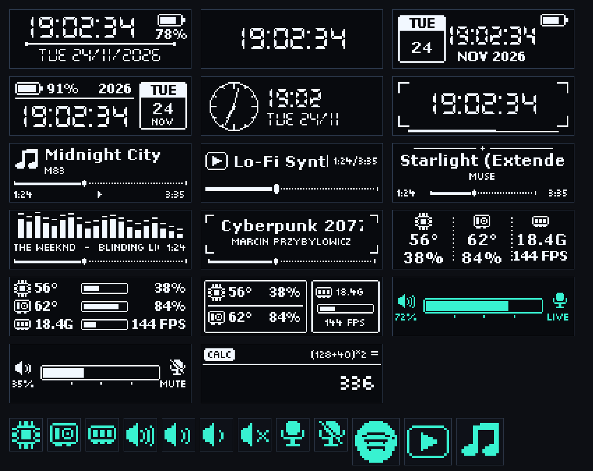

# 🎹 OLED Customizer

**Lightweight native Rust dashboard for SteelSeries 128×40 OLED keyboards.**


OLED Customizer transforms your SteelSeries keyboard's 128×40 monochrome OLED screen into a zero-flicker clock, media player, hardware monitor, volume/mic HUD, and quick calculator — while sipping **~5 MB RAM** in the background and rendering frames in **~0.13 ms**.



> Looking for the original Python version (v1.x)? It's preserved on the [`Python`](https://github.com/0z-zy/OLED_Customizer/tree/Python) branch.

---

## ✨ What's New in v2.0.0 (Native Rust)

- **Ultra-Light Split Architecture**: Headless Win32 tray daemon (~5 MB RAM) + on-demand GPU settings window (`eframe`/`egui`) that launches only when you open Settings.
- **Original Fonts, Razor-Sharp**: Renders your classic `DS-Digital`, `Verdana Bold`, and `Munro Small` TrueType fonts via native hinted Windows GDI (`NONANTIALIASED_QUALITY`) for crisp 1-bit pixel edges.
- **6 Clock Faces**:
  - **Clean Digital**, **Big Bold**, **Split Tech**, **Right Calendar** *(new — bottom-left clock, inline battery + `%` top-left, calendar card on the right)*, **Modern Analog**, and **Minimal Pill**.
  - Upgraded proportional battery icon with smooth charge fill and optional inline/under-icon percentage.
- **5 Media Player Styles**:
  - **Modern Card** (borderless source icons + upgraded scrub bar), **Compact Bar**, **Centered Studio**, **Spectrum Ticker** (real-time WASAPI loopback 512-pt FFT 20-band audio visualizer + peak hold), and **Ultra Minimal**.
- **Hardware Monitor (3 Layouts)**:
  - **3-Column Tech**, **Meter Bars**, and **Compact Split** — powered by native NVML (NVIDIA GPU), embedded LibreHardwareMonitor helper (CPU temps), and embedded `PresentMon.dll` (live game FPS).
- **Headset Battery & Mic Sync**: Direct USB HID battery & mute sync for HyperX / NGENUITY headsets (works even without NGENUITY running).
- **Integrations**: SteelSeries GameSense, per-key RGB color sync, localhost SMTC HTTP Broadcast (`GET /media`), and SignalRGB album-color push.
- **One-Click Admin Startup**: Task Scheduler integration with automatic cold-start elevation so CPU temperature & FPS sensors work seamlessly after a single setup.

---

## ⌨️ Default Hotkeys

| Action | Default Key | Notes |
| :--- | :--- | :--- |
| Peek System Stats | `Insert` | Temporarily shows Hardware Monitor |
| Mute Microphone (Primary) | `Pause` | Supports keyboard keys & Mouse 4/5 |
| Mute Microphone (Secondary) | *Not set* | Bind a second key in Settings |
| Calculator Overlay | `Ctrl + Insert` | Numpad input (`Esc` to close) |

---

## 🛠️ Quick Setup

1. Download **`OLED-Customizer.exe`** from [Releases](https://github.com/0z-zy/OLED_Customizer/releases).
2. Make sure **SteelSeries GG** is installed (and OLED GameSense is active).
3. Run `OLED-Customizer.exe`.
4. *(Optional, for CPU Temp & Game FPS)* Click **Enable Admin via Task Scheduler** in the top banner once — it registers a Windows logon task and remembers your preference.

---

## 🔧 Build from Source

Requires the [Rust toolchain](https://rustup.rs/) on Windows:

```powershell
cargo build --release --bin oled-customizer
```

The compiled binary will be at `target\release\oled-customizer.exe`.
